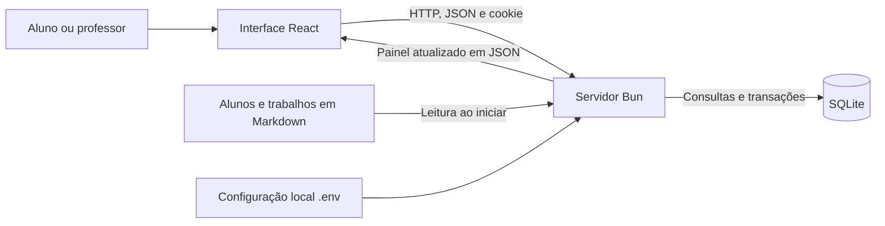
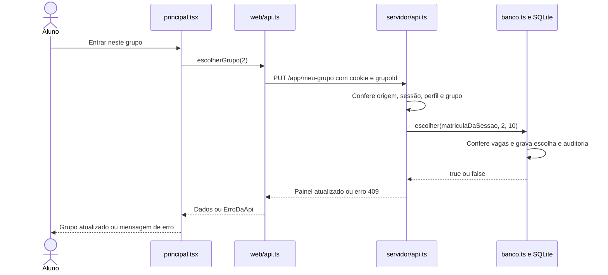
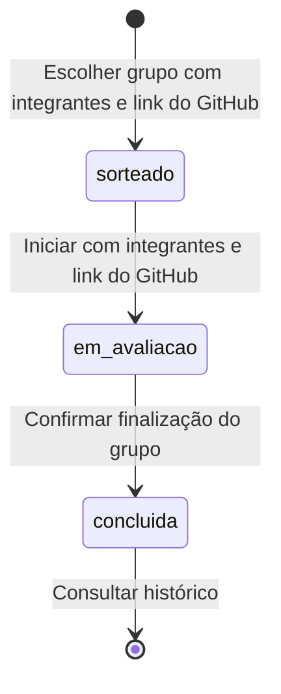

# Arquitetura do Controle N2

Este guia explica como as partes se conectam. Leia o [tutorial](tutorial.md) para executar a aplicação e a [referência da API](docs/api.md) para consultar os contratos.

## 1. O desenho geral

O navegador mostra a interface; o servidor identifica o usuário, aplica as regras e acessa o SQLite. Os arquivos Markdown fornecem os cadastros e os enunciados.



Interface e API são atendidas por `http://127.0.0.1:3400`. Um processo Bun entrega o HTML e os recursos do React e atende as rotas. O navegador usa caminhos relativos, como `/api/painel`.

## 2. Arquivos e responsabilidades

| Arquivo | Responsabilidade |
| --- | --- |
| [src/tipos.ts](src/tipos.ts) | Define `Grupo`, os painéis, as rodadas e as ações de avaliação |
| [servidor/index.ts](src/servidor/index.ts) | Carrega configuração e documentos, abre o banco e inicia HTTP |
| [servidor/configuracao.ts](src/servidor/configuracao.ts) | Valida chave e credenciais do professor |
| [servidor/documentos.ts](src/servidor/documentos.ts) | Converte as tabelas de alunos e os enunciados em estruturas TypeScript |
| [servidor/api.ts](src/servidor/api.ts) | Autentica, autoriza, valida os corpos e monta respostas |
| [servidor/banco.ts](src/servidor/banco.ts) | Cria tabelas, consulta e altera dados em transações |
| [servidor/openapi.ts](src/servidor/openapi.ts) | Descreve o catálogo público e monta a página Scalar |
| [web/principal.tsx](src/web/principal.tsx) | Inicia o React, mantém o painel e coordena acesso e ações |
| [web/professor.tsx](src/web/professor.tsx) | Exibe navegação, cartões de grupos, auditoria e histórico do professor |
| [web/avaliacao.tsx](src/web/avaliacao.tsx) | Exibe integrantes, sorteio, confirmações e rodadas concluídas |
| [web/api.ts](src/web/api.ts) | Centraliza `fetch`, JSON e erros HTTP da interface |
| [web/componentes/ui.tsx](src/web/componentes/ui.tsx) | Fornece botões, campos e cartões reutilizáveis |
| [web/estilos.css](src/web/estilos.css) | Define aparência e estados visuais |

Os comandos [iniciar-grupos.ts](src/servidor/iniciar-grupos.ts) e [auditoria.ts](src/servidor/auditoria.ts) usam a mesma camada de banco, sem iniciar HTTP.

## 3. O que acontece na inicialização

1. O Bun disponibiliza as variáveis de ambiente; o projeto lê `Bun.env`.
2. `lerConfiguracao` exige `APP_KEY` com 64 caracteres hexadecimais, matrícula numérica e nascimento válido do professor.
3. `CONTROLE_N2_DADOS_EXEMPLO` escolhe lista e banco. Somente o valor `1` ativa o exemplo.
4. `lerAlunos` cria um `Map` cuja chave é a matrícula em texto, preservando zeros à esquerda.
5. `lerProjetos` lê os cabeçalhos de `trabalhos.md`. A inicialização exige os grupos de 01 a 10, em sequência.
6. `abrirBanco` cria tabelas e índices ausentes e adapta o formato antigo de duplas, quando encontrado.
7. `criarApi` monta as rotas. Uma matrícula de professor presente na lista de alunos impede a inicialização.
8. `Bun.serve` inicia em `127.0.0.1:3400`. A raiz usa o HTML importado de `src/web/index.html`.

As listas são carregadas na inicialização. Alterar o Markdown exige reiniciar o servidor para garantir a releitura. A configuração atual desativa HMR; atualize o navegador depois de alterar a interface.

## 4. Como os documentos viram dados

Uma linha como esta entra em `lerAlunos`:

```text
| 2610001 | ALANA BEATRIZ COSTA NOGUEIRA | 14/03/2006 |
```

Ela se torna uma entrada equivalente a:

```ts
["2610001", { nome: "Alana Beatriz Costa Nogueira", nascimento: "2006-03-14" }]
```

O leitor normaliza espaços e capitalização, preserva partículas como `de` e `da` e converte o formato da data. Repetições idênticas viram um cadastro só; repetições conflitantes geram erro. O leitor reconhece um formato específico de tabela, por expressões regulares.

Os projetos seguem a estrutura `## Grupo 01: ...`, título de nível 3, descrição e itens `- **Título.** Texto`. Essa convenção faz parte do contrato de entrada, explicado no [guia dos documentos](docs/README.md).

## 5. A viagem de uma escolha de grupo



A matrícula usada na gravação vem da sessão. O aluno informa apenas o destino. A operação usa uma transação imediata: se faltar vaga ou a auditoria falhar, a escolha anterior é preservada.

## 6. Sessões e permissões

O login compara matrícula e nascimento com a lista de alunos ou a configuração do professor. Se estiverem corretos, o servidor gera um token e o envia no cookie `controle_n2_sessao_web`.

| Mecanismo | Comportamento |
| --- | --- |
| Sessões em `Map` | Vivem no processo e expiram após oito horas; reiniciar exige novo login |
| Cookie `HttpOnly` | O JavaScript da página não lê o token diretamente |
| `SameSite=Strict` | Restringe o envio do cookie entre sites |
| `Secure` | É acrescentado quando a URL da requisição usa HTTPS |
| Origem da requisição | As operações da interface exigem `Origin` igual à origem da requisição |
| Perfil da sessão | Aluno altera seu grupo e repositório; professor conduz avaliações |
| Tentativas de login | Após 20 falhas por IP na janela de cinco minutos, a API passa a responder `429` |

A `APP_KEY` é lida no servidor. Os manipuladores de `/app/...` a fornecem internamente a `atender`; o cliente não precisa de campo nem cabeçalho com essa chave. A sessão e o perfil continuam obrigatórios. Veja os [contratos HTTP](docs/api.md).

## 7. Estado da avaliação

O SQLite mantém um estado por grupo e permite apenas uma avaliação ativa por vez.



Grupos vazios, sem link do GitHub ou concluídos ficam fora do sorteio. Repetir **Escolher grupo** conserva um sorteio ainda válido; a seleção de um grupo sorteado que deixou de ser elegível pode ser substituída. O início da avaliação confere as mesmas condições novamente.

Ao iniciar, `avaliacao_integrantes` registra as matrículas daquele momento. Trocas posteriores de grupo não alteram essa lista da avaliação. Nomes são resolvidos pela lista carregada; as matrículas são persistidas.

Cada rodada tem principal, assistente opcional, indicação de pergunta aberta e voluntário opcional. O sorteio considera quem ainda não apareceu em nenhuma rodada, inclusive a ativa. Se sobrar uma pessoa, ela responde sozinha.

| Ação | Efeito persistido |
| --- | --- |
| Finalizar dupla | Marca a rodada como finalizada e libera a escolha da próxima dupla |
| Chamar outro integrante | Abre a pergunta e permite escolher uma pessoa disponível |
| Confirmar pessoa chamada | Guarda um voluntário naquela rodada |
| Finalizar grupo | Encerra a rodada ativa, se houver, e marca o grupo como concluído |

As confirmações acontecem na interface. O servidor valida se a ação ainda corresponde ao `rodadaId` ativo. Isso impede que uma ação de uma tela antiga atinja outra rodada. O grupo também pode ser finalizado entre rodadas, com `rodadaId: null`, se já houver histórico.

Finalizar o grupo não exige que todos tenham participado. O histórico registra o que ocorreu; os critérios de condução da atividade estão em documento próprio. A tela retorna ao painel de grupos, marca o cartão em verde com ✓ e oferece consulta sem controles de alteração.

## 8. Como a interface mantém os dados

`App` consulta `/api/painel` ao abrir a página. Se a consulta falhar, mostra o acesso; com uma sessão válida, escolhe a área pelo campo `perfil`.

Cada alteração retorna um painel completo para atualizar o estado React. Ocupações, colegas, links e avaliações são redesenhados com o resultado aceito pelo servidor. O estado `ocupado` bloqueia cliques durante requisições; `erro` guarda a mensagem exibida.

No painel do professor, o fragmento da URL seleciona a tela:

```text
#professor/grupos
#professor/auditoria
#professor/alunos-sem-grupo
#professor/avaliacao/1
```

O evento `hashchange` atualiza a rota. Ao abrir `/avaliacao/1`, o componente procura o grupo indicado nas avaliações concluídas ou na atual. Isso permite consultar um grupo antigo enquanto outro está em avaliação. `#professor/avaliacao` também abre a atual.

O banco é a fonte do estado persistente. Não há WebSocket nem atualização periódica automática entre navegadores. O professor pode usar **Atualizar painel**, e recarregar a página consulta os dados novamente.

## 9. Decisões e limites da implementação

| Decisão | Motivo ou consequência |
| --- | --- |
| Um processo e uma origem | Interface e API iniciam com um comando |
| Markdown para cadastros e enunciados | Permite estudar transformação de texto sem tela de cadastro |
| Tipos compartilhados por importação | O contrato orienta servidor e cliente; validação HTTP também ocorre em execução |
| SQL com parâmetros e transações | Evita concatenar entradas no SQL e mantém alterações relacionadas juntas |
| Componentes locais e CSS | Facilita localizar a implementação visual e estudar `props` e variantes |
| Histórico de participação | Guarda quem respondeu e em qual papel; perguntas e notas ficam fora do modelo atual |
| Link validado por formato | Exige página HTTPS de repositório GitHub, sem consultar existência, visibilidade ou conteúdo remoto |
| Lista real e configuração locais | Mantém dados pessoais e chave fora do material versionado |

O acesso por matrícula e nascimento é o mecanismo didático desta aplicação. O servidor está configurado para o computador local. Autenticação adicional, HTTPS de hospedagem e operação distribuída exigiriam decisões próprias de implantação.

## 10. Como evoluir uma funcionalidade

Para acrescentar notas individuais, por exemplo, seria necessário modelar o dado em `tipos.ts`, planejar a evolução do SQLite, validar e persistir a nota na API, criar o formulário e atualizar testes e documentação. Uma alteração na tela sozinha não cria uma regra no servidor.

Siga a ordem **tipo → regra e persistência → rota → função cliente → componente → teste**. Os [exercícios](docs/exercicios.md) propõem mudanças graduais.

## Referências

O comportamento pode ser conferido nos arquivos do projeto. Para o mecanismo de empacotamento do HTML, consulte a [documentação oficial de aplicações completas com Bun](https://bun.sh/docs/bundler/fullstack); para a configuração, veja [variáveis de ambiente no Bun](https://bun.sh/docs/runtime/environment-variables).
