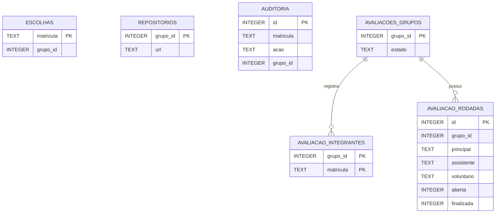

# Banco de dados do Controle N2

A persistência é implementada em [banco.ts](../src/servidor/banco.ts), com `Database` de `bun:sqlite`. O banco guarda escolhas, links, auditoria e avaliações; alunos e enunciados vêm dos documentos Markdown.

## 1. Arquivo e ciclo de vida

| Modo | Arquivo na raiz de `controle_n2` |
| --- | --- |
| `CONTROLE_N2_DADOS_EXEMPLO=1` | `exemplo.sqlite` |
| Normal | `controle_n2.sqlite` |

`caminhoBanco` resolve o endereço a partir da localização do código. `abrirBanco` abre ou cria o arquivo e executa `CREATE TABLE IF NOT EXISTS` e `CREATE INDEX IF NOT EXISTS`. Há seis tabelas.

As credenciais dos alunos, as credenciais configuradas do professor e as sessões não são armazenadas nessas tabelas. Os cadastros de aluno são lidos em memória, e as sessões vivem em `Map`: reiniciar conserva as escolhas e avaliações, mas exige novo login.

## 2. Relacionamentos



As ligações representam relações do domínio. O esquema atual não declara `FOREIGN KEY`: a existência de grupos e a autorização de cada operação são conferidas pelo código. `grupo_id` também relaciona escolhas e repositórios ao catálogo Markdown. Matrículas ligam as tabelas à lista de alunos em memória.

## 3. Tabela `escolhas`

| Coluna | Tipo | Regra |
| --- | --- | --- |
| `matricula` | `TEXT` | Chave primária; uma escolha por aluno |
| `grupo_id` | `INTEGER` | Obrigatório; identifica o grupo de destino |

O índice `escolhas_grupo` auxilia a contagem e busca por grupo. Trocar de grupo faz um `UPSERT` na mesma matrícula. O limite de dez integrantes é conferido pela transação de negócio, antes da escrita, e não por um `CHECK` desta tabela.

```sql
INSERT INTO escolhas (matricula, grupo_id) VALUES (?, ?)
ON CONFLICT (matricula) DO UPDATE SET grupo_id = excluded.grupo_id;
```

A matrícula é texto, preservando zeros à esquerda. A API usa a matrícula da sessão em vez de confiar em uma identidade enviada no formulário.

## 4. Tabela `repositorios`

| Coluna | Tipo | Regra |
| --- | --- | --- |
| `grupo_id` | `INTEGER` | Chave primária; um repositório por grupo |
| `url` | `TEXT` | Obrigatória |

A API valida o formato HTTPS do GitHub. A transação `salvarRepositorio` confere se o aluno pertence ao grupo e grava o link junto com o evento de auditoria. O vínculo é do grupo: quando um aluno troca, o link continua no grupo de origem.

## 5. Auditoria

A tabela `auditoria` registra alterações de inscrição e de repositório que foram aprovadas.

| Coluna | Tipo | Conteúdo ou restrição |
| --- | --- | --- |
| `id` | `INTEGER` | Chave primária; determina a ordem de registro |
| `data_utc` | `TEXT` | Obrigatória; gerada pelo SQLite em UTC no formato ISO com milissegundos |
| `acao` | `TEXT` | Obrigatória; `CHECK` limita às quatro ações abaixo |
| `matricula` | `TEXT` | Obrigatória; quem realizou a operação |
| `grupo_anterior_id` | `INTEGER` | Grupo anterior na troca, ou `NULL` |
| `grupo_id` | `INTEGER` | Obrigatório; destino ou grupo afetado |
| `link_anterior` | `TEXT` | Link anterior, quando aplicável |
| `link_novo` | `TEXT` | Link salvo, quando aplicável |

| Ação | Quando aparece |
| --- | --- |
| `entrada_grupo` | Primeira inscrição, inclusive pelo comando de distribuição |
| `troca_grupo` | Mudança de um grupo para outro |
| `envio_repositorio` | Primeiro link do grupo |
| `alteracao_repositorio` | Substituição do link |

Exemplo de data: `2026-11-19T14:30:00.000Z`. O terminal mostra os valores armazenados em UTC. O painel do professor formata a data no fuso do navegador.

A alteração e seu evento pertencem à mesma transação. Uma falha ao registrar o evento desfaz a alteração. Repetir a escolha ou o link já salvos mantém o histórico. Operações rejeitadas também não criam eventos.

Sorteios, chamadas e encerramentos são persistidos nas tabelas de avaliação; eles não geram linhas nesta auditoria. A aplicação não guarda aqui um histórico de login.

## 6. Tabela `avaliacoes_grupos`

| Coluna | Tipo | Regra |
| --- | --- | --- |
| `grupo_id` | `INTEGER` | Chave primária; um registro de avaliação por grupo |
| `estado` | `TEXT` | Obrigatório; `sorteado`, `em_avaliacao` ou `concluida` |

O índice parcial `uma_avaliacao_ativa` permite uma única linha no conjunto dos estados ativos:

```sql
CREATE UNIQUE INDEX IF NOT EXISTS uma_avaliacao_ativa
ON avaliacoes_grupos ((1))
WHERE estado IN ('sorteado', 'em_avaliacao');
```

A expressão `(1)` tem o mesmo valor para todas as linhas do índice. Como ele é único, só uma linha pode estar em `sorteado` ou `em_avaliacao`. Vários grupos podem estar em `concluida`.

O sorteio exclui grupos concluídos, sem integrantes válidos ou sem linha em `repositorios`. Iniciar exige o grupo sorteado, integrantes e repositório. O encerramento mantém a linha para consulta futura e permite escolher outro grupo.

## 7. Tabela `avaliacao_integrantes`

| Coluna | Tipo | Regra |
| --- | --- | --- |
| `grupo_id` | `INTEGER` | Obrigatório; parte da chave primária composta |
| `matricula` | `TEXT` | Obrigatória; parte da chave primária composta |

Essa tabela é a lista de integrantes registrada no início da avaliação. A chave `(grupo_id, matricula)` impede repetição da mesma pessoa no mesmo registro de grupo.

Se uma pessoa trocar de grupo durante a avaliação, `escolhas` muda, mas a lista da avaliação permanece. Isso mantém consistentes o sorteio e a consulta histórica. Os nomes não são copiados: são obtidos pela matrícula na lista carregada. Se o nome não for encontrado, a resposta usa a própria matrícula.

## 8. Tabela `avaliacao_rodadas`

| Coluna | Tipo | Regra |
| --- | --- | --- |
| `id` | `INTEGER` | Chave primária; identifica a rodada |
| `grupo_id` | `INTEGER` | Obrigatório; grupo avaliado |
| `principal` | `TEXT` | Matrícula obrigatória |
| `assistente` | `TEXT` | Matrícula opcional; `CHECK` impede que seja igual ao principal |
| `aberta` | `INTEGER` | Obrigatório, padrão `0`; `1` indica pergunta aberta aos demais |
| `voluntario` | `TEXT` | Matrícula opcional de quem foi chamado |
| `finalizada` | `INTEGER` | Obrigatório, padrão `0`; `1` indica encerramento da rodada |

O índice parcial `uma_rodada_ativa_por_grupo` torna `grupo_id` único nas linhas com `finalizada = 0`. Assim, cada grupo só pode ter uma rodada ativa.

O código confere que o voluntário está disponível e que a pergunta foi aberta. Ele também exclui participantes de todas as rodadas, inclusive a ativa, dos próximos sorteios. Isso é uma regra da transação, além das restrições estruturais do SQLite.

Não há colunas de nota ou texto da pergunta. O encerramento conserva a rodada, seus papéis e seu voluntário. Na API, os inteiros de estado são convertidos para booleanos.

## 9. Transações e concorrência

Uma transação agrupa operações que devem dar certo juntas. As alterações são expostas por `.immediate`, obtendo a transação de escrita antes de consultar e modificar o estado.

| Operação | O que precisa ficar junto |
| --- | --- |
| Escolher grupo | Conferir lotação, atualizar vínculo e registrar auditoria |
| Salvar repositório | Conferir vínculo, salvar link e registrar auditoria |
| Sortear grupo | Verificar seleção ativa e registrar um candidato elegível |
| Iniciar avaliação | Conferir seleção e link, mudar estado e registrar integrantes |
| Sortear dupla | Consultar participantes e abrir uma única rodada |
| Atualizar avaliação | Conferir grupo e `rodadaId` e alterar a rodada ou encerrar o grupo |
| Iniciar grupos | Planejar vagas, distribuir alunos e registrar todas as inscrições |

A distribuição inicial calcula `meta = totalDeAlunos - Math.round(totalDeAlunos * 0.2)`. Desconta os já inscritos, embaralha os candidatos com Fisher–Yates e escolhe entre os grupos de menor ocupação. Sem vagas suficientes, a operação inteira falha. Repetir o comando após alcançar a meta não refaz os vínculos.

## 10. Consultas para estudar

Execute estas consultas em uma cópia do banco de exemplo. Elas são somente de leitura.

### Ocupação dos grupos com inscrições

```sql
SELECT grupo_id, COUNT(*) AS integrantes
FROM escolhas
GROUP BY grupo_id
ORDER BY grupo_id;
```

Grupos vazios não aparecem nessa consulta, pois seus identificadores vêm do catálogo Markdown e não de uma tabela de grupos.

### Auditoria em ordem de registro

```sql
SELECT id, data_utc, acao, matricula, grupo_anterior_id, grupo_id
FROM auditoria
ORDER BY id;
```

### Estado dos grupos avaliados

```sql
SELECT grupo_id, estado
FROM avaliacoes_grupos
ORDER BY grupo_id;
```

### Rodadas e seus participantes

```sql
SELECT id, grupo_id, principal, assistente, voluntario, aberta, finalizada
FROM avaliacao_rodadas
ORDER BY grupo_id, id;
```

### Quantidade de rodadas concluídas por grupo

```sql
SELECT a.grupo_id, a.estado, COUNT(r.id) AS rodadas_concluidas
FROM avaliacoes_grupos AS a
LEFT JOIN avaliacao_rodadas AS r ON r.grupo_id = a.grupo_id AND r.finalizada = 1
GROUP BY a.grupo_id, a.estado
ORDER BY a.grupo_id;
```

### Consultar usando somente o Bun

Na pasta `controle_n2`, depois que o exemplo tiver criado o banco:

```text
bun -e "const { Database } = require('bun:sqlite'); const db = new Database('exemplo.sqlite', { readonly: true }); console.table(db.query('SELECT grupo_id, estado FROM avaliacoes_grupos ORDER BY grupo_id').all()); db.close();"
```

Para a auditoria, também existe o comando `bun run auditoria`. Ele respeita o modo de dados do ambiente.

## 11. Evolução do esquema e backup

A abertura do banco cria estruturas novas ausentes. Há também uma migração específica que transforma a antiga tabela `avaliacao_duplas` em `avaliacao_rodadas`, preserva a participação e remove a tabela antiga dentro de uma transação.

`CREATE TABLE IF NOT EXISTS` não altera as colunas de uma tabela existente. Uma futura mudança de esquema precisa de uma migração planejada, além da alteração do SQL de criação.

Para guardar ou reiniciar um experimento, pare o servidor antes de copiar ou renomear o banco. O [tutorial](../tutorial.md#7-reiniciar-ou-guardar-os-testes) mostra como conservar o exemplo anterior. Guarde também os documentos de entrada usados no teste. O arquivo local é ignorado pelo Git.

Leia também a [API](api.md), os [testes e exercícios](exercicios.md) e o [guia compartilhado de SQLite](../../docs/banco-de-dados.md).
